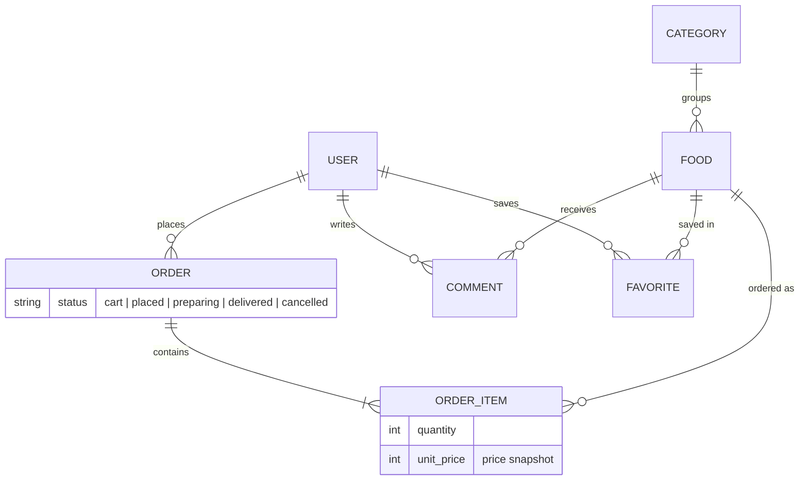

# Restaurant API

A REST API for a restaurant ordering app, built with **Django 5 + Django REST Framework**.
Customers browse the menu, keep a cart, place orders, comment on and favorite foods.
Staff manage the menu and moderate comments from the Django admin.

> **فارسی:** بک‌اند سفارش‌گیری رستوران با جنگو و DRF؛ شامل منو، سبد خرید، ثبت سفارش، کامنت (با تأیید ادمین)، علاقه‌مندی‌ها، احراز هویت JWT، مستندات Swagger، تست خودکار و Docker.

## Features

- JWT authentication (register, login, refresh) with rate limiting on sensitive endpoints
- Menu with categories, search, filtering (category, price range, availability) and ordering
- Cart → checkout → order flow; the price is **snapshotted** at checkout, so later menu changes never alter past orders
- Order lifecycle: `placed → preparing → delivered` (or `cancelled` by the customer while still `placed`)
- Comments hidden until approved by an admin; per-user favorites
- Object-level permissions: users only ever see and change their own cart, orders and favorites
- Interactive API docs (Swagger UI / ReDoc) generated with drf-spectacular
- PostgreSQL, Docker Compose, automated tests and a GitHub Actions pipeline (lint + tests)

## Tech stack

Python 3.12 · Django 5.2 · Django REST Framework · SimpleJWT · django-filter · drf-spectacular ·
PostgreSQL 17 · Gunicorn + WhiteNoise · Docker

## Data model



A user has at most one `cart` order at a time (enforced by a partial unique constraint).

## Quick start (Docker)

```bash
git clone https://github.com/alyhoseinpoor/restaurant.git
cd restaurant
cp .env.example .env        # then edit SECRET_KEY and DB_PASSWORD
docker compose up --build
docker compose exec web python manage.py createsuperuser
```

- API docs: http://localhost:8000/api/docs/
- Admin: http://localhost:8000/admin/

`DEBUG=True` in `.env.example` is meant for local demos only (it also serves uploaded images).
Set `DEBUG=False` and a real `ALLOWED_HOSTS` in production and serve `/media/` with a web server such as nginx.

## Run without Docker

```bash
python -m venv .venv && source .venv/bin/activate     # Windows: .venv\Scripts\activate
pip install -r requirements.txt
cp .env.example .env     # set SECRET_KEY and leave DB_NAME empty to use SQLite
python manage.py migrate
python manage.py createsuperuser
python manage.py runserver
```

## Tests

```bash
python manage.py test
```

The suite covers authentication, menu permissions and filters, the cart, checkout and
order lifecycle, ownership rules, comment moderation and the OpenAPI schema.

## API overview

| Area | Endpoint | Notes |
|------|----------|-------|
| Auth | `POST /api/register/` | create an account |
| | `POST /api/token/`, `POST /api/token/refresh/` | JWT access / refresh |
| Menu | `GET /api/categories/`, `GET /api/foods/` | public. Query: `search`, `category` (slug), `min_price`, `max_price`, `available`, `ordering`, `page` |
| | `POST/PUT/PATCH/DELETE` on the same URLs | staff only |
| Cart | `GET /api/cart/`, `DELETE /api/cart/` | view / empty the cart |
| | `POST /api/cart/items/` | `{food, quantity}`; adding the same food increases the quantity |
| | `PATCH/DELETE /api/cart/items/{id}/` | change quantity / remove |
| | `POST /api/cart/checkout/` | places the order |
| Orders | `GET /api/orders/`, `GET /api/orders/{id}/` | your order history |
| | `POST /api/orders/{id}/cancel/` | only while `placed` |
| Comments | `GET /api/comments/?food={id}` | approved comments only |
| | `POST /api/comments/` | requires login; visible after admin approval |
| Favorites | `GET/POST /api/favorites/`, `DELETE /api/favorites/{id}/` | |
| Docs | `/api/docs/`, `/api/redoc/`, `/api/schema/` | |

Authenticate with the header `Authorization: Bearer <access token>`.
A Postman collection is available in [`docs/`](docs/).

## Design decisions

- **Cart and order are one model** with a `status`, so checkout is a state change rather than a copy.
- **`OrderItem.unit_price`** stores the price at the time of checkout; items are re-priced when the order is placed.
- **`on_delete=PROTECT`** on `Food → Category` and `OrderItem → Food` so history cannot be destroyed by accident; the API answers with a clear 400 and suggests marking a food unavailable.
- **Secure by default:** the global permission is `IsAuthenticated`; public endpoints opt in explicitly.
- **Checkout runs in a transaction** with a row lock on the cart to avoid double submission.

## Possible next steps

Online payment integration, order status notifications, API versioning (`/api/v1/`), caching the menu.
